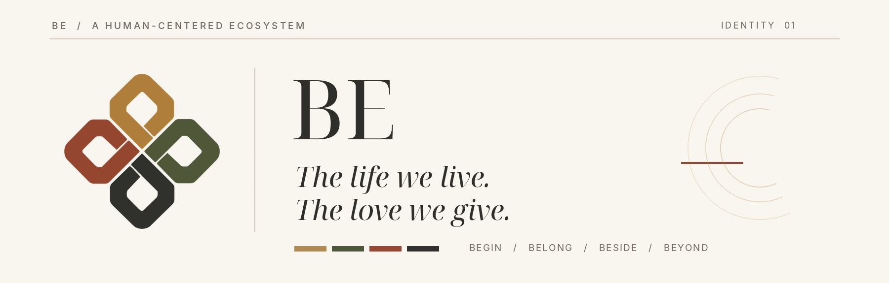
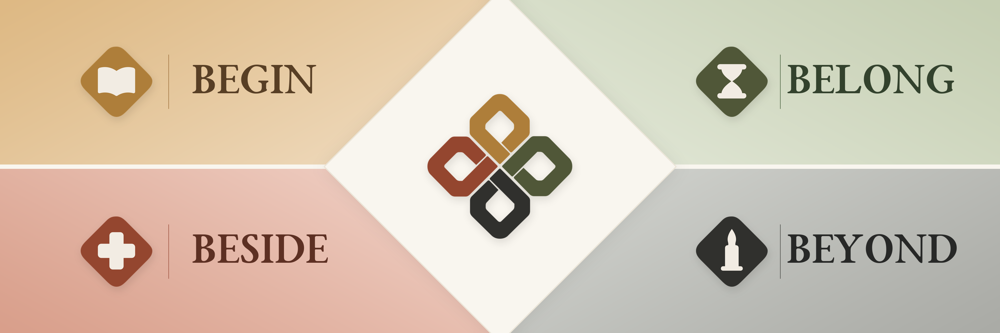
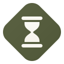
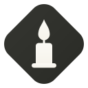
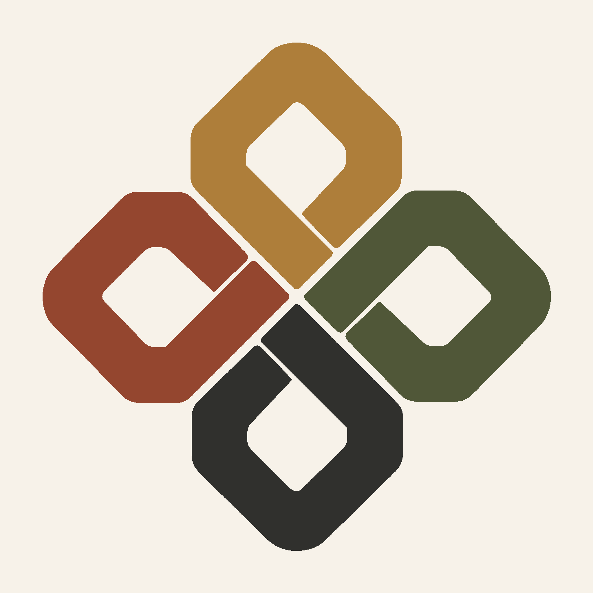

 

  

## Cuộc đời ta sống. Yêu thương ta trao.

---

## Một đời người, nhiều cách ở bên.

Có những điều ta mang theo từ lúc chào đời. Có những điều được trao cho ta qua năm tháng. Và có những điều, dù thời gian đi qua, vẫn ở lại trong cuộc đời người khác.

Sinh, lão, bệnh, tử là những chặng đường tự nhiên của đời người. Chính sự hữu hạn ấy khiến ta muốn **sống trọn vẹn hơn, quan tâm nhiều hơn, và gìn giữ những điều gần gũi nhất.**

**BE** được hình thành để sự quan tâm ấy có nơi tiếp nối: nơi hiểu biết được sẻ chia, trải nghiệm được trao lại, sự đồng hành được kết nối và ký ức được nâng niu.

---

## Những chặng đường của BE

  

### BEGIN — Sinh · Khởi đầu

Nâng niu những khởi đầu, chia sẻ hiểu biết và đồng hành cùng sự trưởng thành.

### BELONG — Lão · Thuộc về

Kết nối các thế hệ, trân trọng năm tháng đã qua và những kinh nghiệm được trao truyền.

### BESIDE — Bệnh · Đồng hành

Để người cần được chăm sóc và người muốn ở bên có thêm sự thấu hiểu, sẻ chia.

### BEYOND — Tử · Tiếp nối

Gìn giữ ký ức, tôn trọng những cuộc đời và nâng niu các giá trị còn ở lại.

---

## Điều chúng tôi tin

### Con người, trước công nghệ.

Công nghệ chỉ có ý nghĩa khi giúp ta hiểu nhau và quan tâm đến nhau tốt hơn.

### Sự chăm sóc bắt đầu từ thấu hiểu.

Mỗi người có hành trình riêng, cùng với những lựa chọn, giới hạn và quyền riêng tư đáng được tôn trọng.

### Những điều đẹp đẽ có thể được trao lại.

Một lời kể, một kinh nghiệm, một ký ức — đôi khi là điều quý giá nhất ta để lại cho nhau.

---

  

<h2 align="center">BE</h2>

<h3 align="center">The life we live. The love we give.</h3>

  <em>Một hệ sinh thái đang được định hình, lấy con người và sự quan tâm làm trung tâm.</em>

